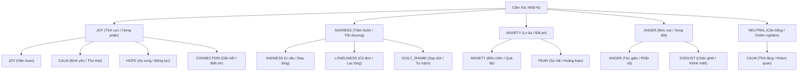
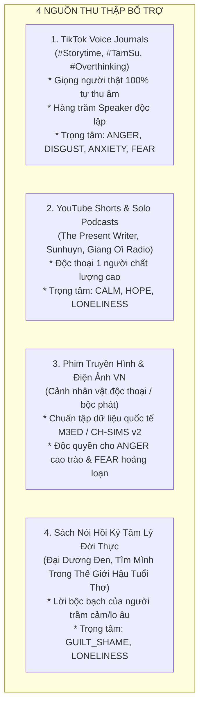
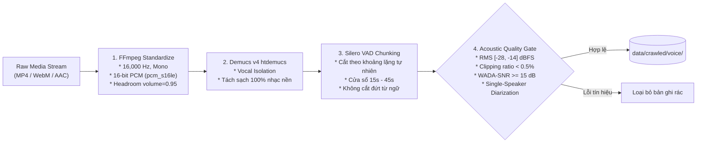

# ĐẶC TẢ HỆ THỐNG THU THẬP & CHUẨN HÓA DỮ LIỆU ÂM THANH ĐA PHƯƠNG THỨC CHO NHẬT KÝ CẢM XÚC TIẾNG VIỆT (MER STAGE 2)
## Multimodal Speech Emotion Data Harvesting & Curation Architecture Specification

* **Dự án:** Multimodal Emotion Recognition for Vietnamese Language Diary (*Emotion Journal AI*)
* **Miền ứng dụng:** Nhận diện cảm xúc đa phương thức cho nhật ký cá nhân và sức khỏe tinh thần
* **Cấp độ kiến trúc:** Stage 2 SOTA (Hybrid Acoustic + Semantic + Gated Fusion + Hierarchical Logit Masking)
* **Tài liệu:** Báo cáo Kiến trúc & Đặc tả Kỹ thuật Hệ thống Thu thập Dữ liệu (System Architectural Specification)

---

## 1. TỔNG QUAN HỆ THỐNG & MỤC TIÊU KHOA HỌC

### 1.1. Bối cảnh & Đóng góp Khoa học (Scientific Novelty)
Phần lớn các nghiên cứu nhận diện cảm xúc giọng nói (Speech Emotion Recognition - SER) tại Việt Nam hiện nay chủ yếu dựa vào các tập dữ liệu diễn kịch kịch bản (acted datasets như ViSEC) với 4 cảm xúc cơ bản (*Vui, Buồn, Giận, Trung tính*). Dữ liệu diễn kịch thiếu đi tính tự nhiên đời thường (spontaneous dynamics) và hoàn toàn vắng bóng các trạng thái tâm lý cốt lõi của nhật ký sức khỏe tinh thần như **`ANXIETY` (Lo âu/Áp lực), `FEAR` (Sợ hãi), `GUILT_SHAME` (Day dứt/Mặc cảm), và `LONELINESS` (Cô đơn)**.

Hệ thống **Voice Harvesting & Curation Pipeline v3** được thiết kế nhằm xây dựng tập dữ liệu đa phương thức tiếng Việt tự nhiên (In-the-wild Multimodal Dataset) đầu tiên chuyên biệt cho văn phong tự sự nhật ký. Dữ liệu đầu ra cung cấp các cặp đồng bộ chính xác cao `(Waveform 16kHz, Verbatim Transcript, Primary Label, Sub Label)` phục vụ trực tiếp cho mô hình **Stage 2 SOTA Hierarchical Multimodal Emotion Recognition**.

### 1.2. Mối Liên Kết Trực Tiếp Với Kiến Trúc Mô Hình Stage 2
Dữ liệu thu thập từ pipeline này đáp ứng chính xác cấu trúc đầu vào của các nhánh mạng trong Stage 2:
* **Nhánh Acoustic Encoder:** Sóng âm WAV 16kHz Mono được nạp đồng thời vào `emotion2vec+` (768 chiều) trích xuất ngữ nghĩa âm thanh, `ExplicitMelodyExtractor` (32 chiều) trích xuất đặc trưng thanh điệu tiếng Việt (F0 contour, jitter, shimmer, HNR), và `PauseAnalyzer` (128 chiều) đo lường khoảng lặng và tiếng thở dài.
* **Nhánh Semantic Encoder:** Transcript lời thoại thực tế được mã hóa bởi `PhoBERT v2` (768 chiều).
* **Nhánh Gated Fusion:** Cơ chế cổng chéo (Cross-Modal Sigmoid Gate) cân bằng trọng số đóng góp giữa Giọng nói và Lời nói.
* **Phân tầng Hierarchical Inference Mask:** Dự đoán đồng thời 5 lớp Primary và 11 lớp Sub-emotions, áp dụng mặt nạ $-\infty$ triệt tiêu hoàn toàn vi phạm logic phân tầng.

---

## 2. KHUNG PHÂN TẦNG CẢM XÚC & QUY TẮC CÂN BẰNG DỮ LIỆU

### 2.1. Dual-Head Hierarchical Taxonomy (`data/taxonomy.json`)
Dữ liệu được tổ chức theo cấu trúc phân tầng 2 cấp độ:



### 2.2. Hiện Tượng Cảm Xúc Đa Tầng (Multi-label Dynamics) & Cân Bằng Nhãn
Trong nhật ký tự sự, cảm xúc con người thường mang tính pha trộn (Mixed Emotions):
* **Sự đồng xuất hiện (Co-occurrence):** Một bài nói có thể chứa đồng thời `SADNESS` + `LONELINESS`, hoặc `ANXIETY` + `FEAR`. Pipeline hỗ trợ cấu trúc nhãn chính (Primary bắt buộc) kết hợp nhãn phụ (Secondary Sub-emotions), cho phép một bản ghi đóng góp giá trị cho nhiều chiều cảm xúc.
* **Tương thích với LDAM Loss & DRW:** Mô hình Stage 2 sử dụng hàm mất mát `LDAMLoss` ép biên phân cách $\Delta_j \propto N_j^{-1/4}$ cho các lớp hiếm. Để tránh hiện tượng sụp đổ biểu diễn (Representation Collapse), pipeline thiết lập quy chuẩn cân bằng dữ liệu:
  * Tỷ lệ mất cân bằng giữa lớp nhiều nhất và ít nhất: $\text{Imbalance Ratio} \le 10:1$.
  * Lớp hiếm nhất (`FEAR`, `GUILT_SHAME`, `DISGUST`) bắt buộc phải đạt tối thiểu **35 – 50 mẫu độc lập** từ các người nói khác nhau.

---

## 3. BẢN ĐỒ NGUỒN THU THẬP ĐA PHƯƠNG THỨC (MULTI-SOURCE INGESTION)

Hệ thống kết hợp 4 nguồn dữ liệu đời thực nhằm đảm bảo tính tự nhiên, độ đa dạng người nói và độ bao phủ toàn diện 11 nhãn cảm xúc:



### 3.1. Nguồn 1: TikTok Voice Journals & Storytime
* **Giá trị khoa học:** Là nguồn cung cấp giọng nói tự nhiên (Spontaneous Speech) phong phú nhất, chứa trọn vẹn những tiếng thở dài, tiếng nấc thật khi khóc, và ngữ điệu đời thường của người trẻ.
* **Cơ chế kỹ thuật vượt rào cản:**
  * Khởi tạo phiên trình duyệt Playwright với Cookie xác thực (`tiktok_cookies.json`), mô phỏng người dùng thật để vượt qua hoàn toàn cơ chế Anti-bot và Guest Login Interstitial.
  * Chặn bắt trực tiếp các gói tin phản hồi API để lấy link CDN stream MP4 gốc độ phân giải cao.
* **Chiến lược khai thác triệt để (Không phụ thuộc vào Hashtag hay Caption):**
  1. **Khai thác theo Âm thanh gốc (Original Sound ID):** Thu thập toàn bộ các video sử dụng cùng một đoạn âm thanh trải lòng tự sự, bất kể người đăng có gắn hashtag hay không.
  2. **Khai thác theo Danh mục Creator Hạt giống (Seed Creators):** Quét trực tiếp toàn bộ video từ danh sách 30 creator chuyên làm nhật ký âm thanh, radio tâm sự đêm muộn.
  3. **Duyệt theo Đồ thị Đề xuất (Related Video Graph Walk):** Sử dụng thuật toán phân phối nội dung của nền tảng để duyệt sâu (Breadth-First Search) theo các video liên quan cùng tần số cảm xúc.

### 3.2. Nguồn 2: YouTube Shorts & Solo-Host Podcasts
* **Giá trị khoa học:** Cung cấp các đoạn độc thoại có chiều sâu nội tâm cao, ngôn ngữ tự sự ngôi thứ nhất chuẩn mực, chất lượng thu âm đạt chuẩn phòng thu cá nhân.
* **Cơ chế kỹ thuật:**
  * Sử dụng `yt-dlp` kết hợp **Negative Keywords** (`-karaoke -nhạc -truyện -cover`) và lọc thời lượng ($15\text{s} \le \text{duration} \le 180\text{s}$) nhằm loại bỏ triệt để các bài hát và tiểu thuyết hư cấu.
  * Quét toàn bộ video từ các kênh độc thoại uy tín: *The Present Writer, Sunhuyn Podcast, Giang Ơi Radio, Trải Lòng Cùng Bạn*.

### 3.3. Nguồn 3: Phim Truyền Hình & Điện Ảnh Việt Nam (Phân Cảnh Độc Thoại)
* **Giá trị khoa học:** Tham chiếu theo phương pháp luận của các tập dữ liệu benchmark quốc tế (**M3ED**, **CH-SIMS v2**). Đây là nguồn duy nhất cung cấp các trạng thái cảm xúc năng lượng cao (High Arousal) bộc phát dữ dội như **`ANGER` (Gào thét, tức giận)** và **`FEAR` (Hoảng loạn tột độ)**.
* **Đặc tính:** Cắt theo phụ đề chính thức của phim, đảm bảo transcript văn bản chính xác 100%.

### 3.4. Nguồn 4: Sách Nói Hồi Ký Tâm Lý Đời Thực
* **Giá trị khoa học:** Khai thác các tác phẩm tài liệu tâm lý học ghi lại lời kể trực tiếp của nhân chứng (*Đại Dương Đen*, *Tìm Mình Trong Thế Giới Hậu Tuổi Thơ*), cung cấp nguồn dữ liệu mẫu mực cho cảm xúc nội tâm sâu kín **`GUILT_SHAME` (Tự trách/Mặc cảm)**.

---

## 4. QUY TRÌNH XỬ LÝ TÍN HIỆU ÂM HỌC (ACOUSTIC SIGNAL INTEGRITY PIPELINE)

Toàn bộ mẫu âm thanh trước khi đưa vào kho lưu trữ phải vượt qua 4 công đoạn xử lý và cổng kiểm định tín hiệu nghiêm ngặt:



### 4.1. Tiêu Chuẩn Kỹ Thuật Chi Tiết Tại Cổng Kiểm Định (Quality Gate Criteria)

| Thông Số / Chỉ Số | Ngưỡng Cho Phép | Căn Cứ & Tiêu Chuẩn Khoa Học |
| :--- | :--- | :--- |
| **Định dạng mã hóa** | WAV, 16,000 Hz, Mono, 16-bit linear PCM | Chuẩn bất biến của `emotion2vec+` và VinAI PhoWhisper. |
| **Độ lớn tích hợp (Loudness)** | $-28.0\text{ dBFS} \le \text{RMS} \le -14.0\text{ dBFS}$ | Tiêu chuẩn phát thanh **EBU R128 / ITU-R BS.1770-4**, triệt tiêu sai lệch âm lượng giữa các nguồn. |
| **Tỷ lệ rè méo (Clipping)** | $\text{Clipping Ratio} < 0.5\%$ (Peak $< 0.98$) | Tiêu chuẩn **EBU Tech 3343**, đảm bảo tín hiệu không bị méo hài do quá tải micro. |
| **Tỷ lệ tiếng nói hữu ích** | $\text{Speech Activity Ratio} \ge 70.0\%$ | Khuyến nghị **NIST OpenSAT & Emilia-Pipe (Interspeech 2024)**, loại bỏ đoạn lặng kéo dài $> 1.5$s. |
| **Tỷ lệ tín hiệu trên tạp âm** | $\text{WADA-SNR} \ge 15.0\text{ dB}$ (Sàn nhiễu $\le -50\text{ dBFS}$) | Loại trừ tạp âm môi trường, tiếng quạt gió và tiếng sôi nền micro (Hiss noise). |
| **Độ tinh khiết người nói** | Single-Speaker Verification (Diarization Purity) | Đo lường tính ổn định của cao độ F0, loại bỏ triệt để đoạn có 2 người nói chen ngang. |
| **Độ dài phân đoạn (Chunk)** | $15.0\text{s} \le \text{Duration} \le 45.0\text{s}$ | Tối ưu cho Receptive Field và Temporal Attention Pooling (cửa sổ 6.0s) của Stage 2. |

---

## 5. ĐỒNG BỘ ĐA PHƯƠNG THỨC & GÁN NHÃN ĐỘNG (MULTIMODAL ALIGNMENT)

### 5.1. Nguyên Lý "Audio-First" Bóc Tách Văn Bản Thực Tế
* Hệ thống không sử dụng dòng caption tóm tắt trên mạng xã hội để làm văn bản cho audio.
* File âm thanh sau khi vượt qua Quality Gate được đưa trực tiếp qua mô hình **`vinai/phowhisper-base` ASR** để phục hồi nguyên văn lời nói thực tế (Verbatim Transcript) kèm khôi phục dấu câu tiếng Việt chuẩn.
* Mọi mẫu trong `data/crawled/text_voice/` đều đảm bảo sự tương ứng chính xác $100\%$ giữa âm thanh phát ra và văn bản ghi lại, bảo vệ tầng Gated Fusion học đúng mối tương quan đa phương thức.

### 5.2. Đánh Giá Tự Sự Bằng `JournalFilter`
Transcript ASR được kiểm định qua bộ lọc nội dung:
* Bắt buộc có đại từ nhân xưng tự sự ngôi thứ nhất: *"tôi", "mình", "em", "bản thân"*.
* Nhận diện các cấu trúc biểu đạt nội tâm: *"áp lực", "cô đơn", "khóc", "hối hận", "không biết đi về đâu", "bình yên"*.
* Loại trừ hoàn toàn các mẫu tin tức thời sự, đọc truyện hư cấu, bán hàng online, và quảng cáo khóa học.

### 5.3. Gán Nhãn Động Theo Từng Phân Đoạn (Dynamic Chunk-Level Labeling)
Hệ thống chấm điểm và gán nhãn cảm xúc độc lập cho từng phân đoạn 30s dựa trên sự kết hợp giữa:
1. **Phân tích ngữ nghĩa văn bản (Semantic Dynamics):** PhoBERT zero-shot phân loại trên transcript của đoạn.
2. **Đặc trưng âm học kích hoạt (Acoustic Arousal):** Mức năng lượng RMS và biên độ biến thiên F0 của giọng nói.
3. **Phát hiện mâu thuẫn cảm xúc (Emotion Masking):** Ghi nhận các trường hợp lời nói bình thản (*"Tôi vẫn ổn mà"*) nhưng ngữ điệu nghẹn ngào, rung rẩy $\rightarrow$ Đóng góp giá trị học thuật xuất sắc cho bài báo khoa học.

---

## 6. KHUNG ĐẠO ĐỨC, PHÁP LÝ & AN TOÀN DỮ LIỆU

### 6.1. Tuân Thủ Nghị Định 91/2025/QH15 Về Dữ Liệu Cá Nhân
Giọng nói được xếp vào nhóm dữ liệu sinh trắc học nhạy cảm. Hệ thống thiết lập quy trình khử định danh nghiêm ngặt:
* **Ẩn danh hóa danh tính (Author Hashing):** Tuyệt đối không lưu username hay đường link gốc ở dạng plain-text. Định danh tác giả được băm một chiều:
  $$\text{author\_hash} = \text{SHA256}(\text{platform} + \text{channel\_id} + \text{salt})[:12]$$
* **Khử thông tin cá nhân (PII Redaction):** Quét toàn bộ transcript qua bộ nhận diện Regex + NER để thay thế số điện thoại bằng `[PHONE]`, địa chỉ email bằng `[EMAIL]`, địa chỉ nhà bằng `[LOCATION]`.

### 6.2. Phân Luồng Cách Ly Khủng Hoảng (Crisis Quarantine Protocol)
Tuân thủ thang đo lâm sàng Columbia-Suicide Severity Rating Scale (C-SSRS):
* Khi phát hiện các từ khóa hoặc ngữ cảnh tự hại nghiêm trọng (*"tự tử", "muốn chết", "kết thúc cuộc đời", "nhảy lầu"*), hệ thống tự động ngắt mẫu ra khỏi luồng huấn luyện thông thường và lưu trữ riêng biệt tại `data/crawled/crisis_quarantine/`.

---

## 7. CẤU TRÚC LƯU TRỮ & HỢP ĐỒNG DỮ LIỆU (DATA CONTRACT)

### 7.1. Cấu Trúc Thư Mục Trên Ổ Đĩa
```text
data/crawled/
├── voice/                   # Âm thanh độc thoại thuần (.wav + .json metadata âm học)
├── text_voice/              # Cặp đôi đa phương thức (.wav + .json transcript ASR)
├── crisis_quarantine/       # Khu vực cách ly ca khủng hoảng tâm lý
├── metadata.csv             # Bảng chỉ mục metadata tổng hợp (phục vụ GroupKFold)
└── metadata.jsonl           # Stream metadata dạng JSON Lines (hỗ trợ cào nối tiếp resumable)
```

### 7.2. Chuẩn Dữ Liệu Đầu Ra Chi Tiết (`data/crawled/text_voice/<sample_id>.json`)
```json
{
  "sample_id": "tiktok_voice_8f12a3b4",
  "modality": "text_voice",
  "text": "Đêm nay mình lại ngồi một mình trong phòng trọ, cảm giác bất lực và sợ hãi tương lai cứ bủa vây...",
  "primary_label": "ANXIETY",
  "sub_label": "FEAR",
  "emotion_score": 0.92,
  "author_hash": "e3b0c44298fc",
  "source_platform": "tiktok_voice_journal",
  "duration_s": 32.4,
  "acoustic_metrics": {
    "rms_dbfs": -18.2,
    "peak_amplitude": 0.89,
    "clipping_ratio": 0.0001,
    "speech_ratio": 0.86,
    "wada_snr_db": 22.4,
    "noise_floor_dbfs": -54.1,
    "single_speaker": true
  },
  "narrative_metrics": {
    "narrative_score": 1.0,
    "matched_pronouns": ["mình"],
    "introspective_triggers": ["đêm nay", "một mình", "bất lực", "sợ hãi"]
  },
  "crawled_at": "2026-10-12T01:00:00"
}
```

### 7.3. Chia Tập Chống Rò Rỉ Tác Giả (Participant-Aware Partitioning)
Khi nạp vào Stage 2 (`train_stage2.py`), tập dữ liệu bắt buộc được phân chia thành **Train (80%) / Val (10%) / Test (10%)** bằng thuật toán `StratifiedGroupKFold` theo trường **`author_hash`**:
* Toàn bộ các đoạn cắt âm thanh của cùng một tác giả chỉ được phép nằm trọn vẹn ở tập Train HOẶC tập Test.
* **Ý nghĩa khoa học:** Ngăn chặn hiện tượng mô hình học thuộc chất giọng cá nhân (Speaker Overfitting), đảm bảo điểm số F1-Score phản ánh năng lực nhận diện cảm xúc thực tế.

---

## 8. LỘ TRÌNH TRIỂN KHAI KỸ THUẬT (ENGINEERING IMPLEMENTATION ROADMAP)

Hệ thống được đóng gói thành các module chuyên biệt trong thư mục `scripts/crawler/`:

| Module | Tên File | Trách Nhiệm Kỹ Thuật |
| :--- | :--- | :--- |
| **Session Manager** | [`save_tiktok_session.py`](file:///d:/TravisL/emotion-journal-ai/scripts/crawler/save_tiktok_session.py) | Khởi tạo Playwright mở Chrome thật, đăng nhập và xuất `tiktok_cookies.json`. |
| **TikTok Crawler** | [`crawler_tiktok.py`](file:///d:/TravisL/emotion-journal-ai/scripts/crawler/crawler_tiktok.py) | Cào video TikTok theo danh sách Creator Hạt giống, Âm thanh gốc, và đồ thị liên quan. |
| **YouTube & Podcast** | [`crawler_voice_radio.py`](file:///d:/TravisL/emotion-journal-ai/scripts/crawler/crawler_voice_radio.py) | Thu thập YouTube Shorts/Podcasts, áp dụng Negative Keywords và quét Playlist. |
| **Acoustic Processor** | [`voice_processor.py`](file:///d:/TravisL/emotion-journal-ai/scripts/crawler/voice_processor.py) | Tích hợp Demucs v4, Silence-Aware VAD Chunking, kiểm định RMS, Clipping, và WADA-SNR. |
| **Dataset Manager** | [`dataset_manager.py`](file:///d:/TravisL/emotion-journal-ai/scripts/crawler/dataset_manager.py) | Băm `author_hash`, quản lý kho lưu trữ, cách ly crisis, xuất CSV/JSONL metadata. |
| **CLI Runner** | [`run_crawler.py`](file:///d:/TravisL/emotion-journal-ai/scripts/crawler/run_crawler.py) | Bộ điều khiển trung tâm hợp nhất toàn bộ pipeline thu thập và báo cáo thống kê. |
